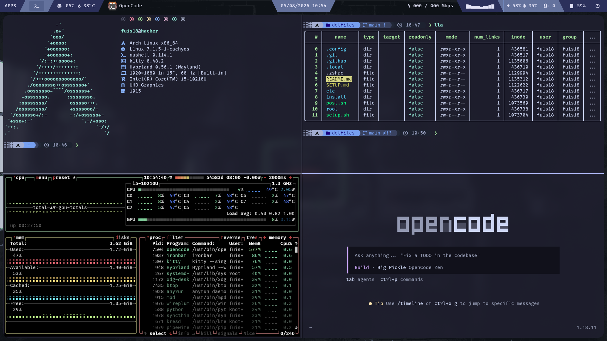
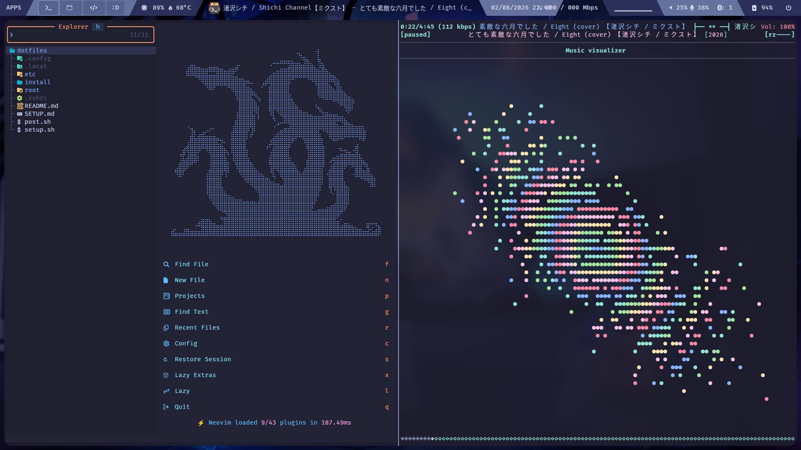
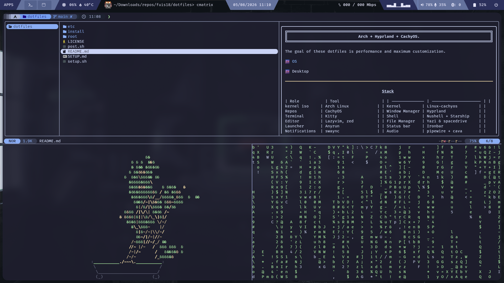

# Arch + Hyprland + CachyOS.

The goal of these dotfiles is maximum performance and greatest customization.

[](https://archlinux.org)
[](https://hyprland.org)
[](https://cachyos.org)




---

## Stack

### Core

| Role           | Tool                |
| -------------- | ------------------- |
| kernel iso     | Arch Linux          |
| Kernel         | Linux-cachyos       |
| Repos          | CachyOS             |
| Window Manager | Hyprland            |
| Network        | iwd + Knot Resolver |
| Launcher       | Anyrun              |
| Status bar     | Ironbar             |
| Notifications  | swaync              |
| Login Manager  | greetd + regreet    |
| Power menu     | wlogout             |

### TUIs

| Role           | Tool     |
| -------------- | -------- |
| Terminal       | Kitty    |
|                | Starship |
| Shell 1        | Nushell  |
| Shell 2        | zsh      |
| Editor         | Lazyvim  |
| File Manager 1 | Yazi     |
| Music          | ncmpcpp  |
| Bluetooth      | bluetui  |

### GUIs

| Role           | Tool           |
| -------------- | -------------- |
| File Manager 1 | Nautilus       |
| File Manager 2 | spacedrive     |
| Editor         | zed editor     |
| Browser 1      | Helium Browser |
| Browser 2      | Zen Browser    |

---

## Install

### Enable to the network

```sh
ip addr
sudo ip link set enp0s3 up
```

### Connect to the network

```sh
sudo systemctl enable --now iwd
iwctl station wlan0 connect "SSID"

sudo pacman -S dhcpcd
sudo dhcpcd enp0s3
```

### Clone and run

```sh
sudo pacman -S git

git clone https://github.com/fuis18/dotfiles.git

sudo cp -r dotfiles/etc/. /etc/
sudo chmod +x /etc/greetd/start-greeter
```

Edit /etc/knot-resolver/config.yaml for your dns

```sh
sudo bash dotfiles/setup.sh
sudo zsh dotfiles/post.sh
```

> For full disk partitioning and bootloader setup, see [SETUP.md](./SETUP.md).

## Greeter (greetd + regreet + cage)

The greeter runs inside a **patched cage** installed to `/usr/local/bin/cage`
(pacman's cage in `/usr/bin/cage` stays untouched, so package updates never break it).

| Piece                              | Role                                                                               |
| ---------------------------------- | ---------------------------------------------------------------------------------- |
| `etc/greetd/config.toml`           | greetd config: just runs the wrapper below                                         |
| `etc/greetd/start-greeter`         | dbus session + cage + regreet, sets `CAGE_FORCE_MODE`, logs                        |
| `build/cage/build.sh`              | downloads cage 0.3.1, applies the patch, builds, installs to `/usr/local/bin/cage` |
| `build/cage/force-1920x1080.patch` | makes cage honour `CAGE_FORCE_MODE=WxH@Hz` (or `off`)                              |

**Why the patch**: the eDP panel's EDID preferred mode is `1366x768@60`, and cage
upstream always picks the preferred mode — so the greeter rendered at 1366x768 while
Hyprland runs at `1920x1080`, making the whole greeter UI look ~41% larger. The patch
forces a custom mode that i915 scales to the panel, the same path Hyprland uses.

**Cursor size**: the greeter uses `cursor-size=42` because GTK4 draws the cursor at
`1024 / cursor_theme_size` px (42 → ≈24 px, matching the desktop). That value is read
by the settings portal from `/var/lib/greetd/.config`, so the `greeter` user's home in
`/etc/passwd` must be `/var/lib/greetd` — `install/system-1.sh` enforces it.

**greetd runs `command` as `exec <command>`**: a `VAR=x ...` prefix in `config.toml`
would be taken as the binary and the greeter never starts. Keep all setup inside
`start-greeter` instead.

**After changing `config.toml` or `start-greeter`**: `sudo systemctl restart greetd`
(config is read only at startup). With `vt = 1` a restart steals VT1 from a running
session — cleaner to just reboot.

**Verify**:

```sh
tail -f /var/log/greetd-greeter.log   # e.g. "Modo forzado 1920x1080@60 aplicado en eDP-1"
```

## TODO

- Ironbar to AGS
- Arch to Boruin (s6 & 66)
- config niri
